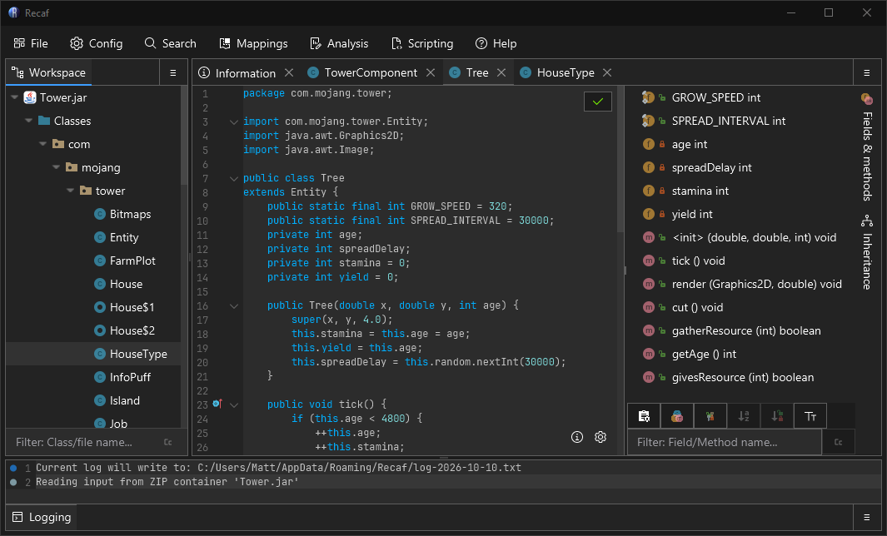
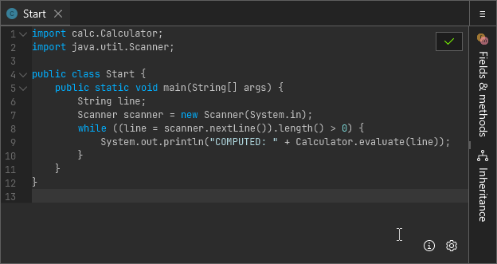
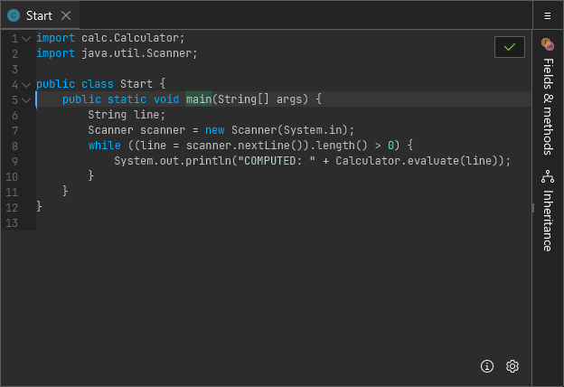
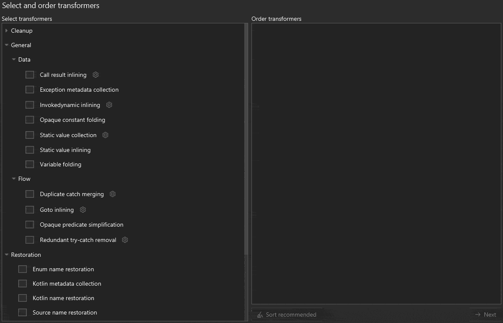

# Recaf     

A versatile and easy to use Java and Android bytecode editor. Recaf makes working with compiled Java applications easier. Explore unfamiliar code, analyze obfuscated applications, modify classes without their original source, and export your changes, all through a familiar IDE-like interface.

## Download

- [Launcher](https://github.com/Col-E/Recaf-Launcher)
  - Pulls snapshot releases from GitHub CI runs, ensuring you have the most up-to-date releases.
  - Usage & instructions for the launcher can be found on the launcher repo.
- [Snapshot releases](https://github.com/Col-E/Recaf-Launcher/blob/master/MANUAL.md)
  - See [CI actions](https://github.com/Col-E/Recaf/actions/workflows/build.yml) for release artifacts.
- [Independent releases](https://github.com/Col-E/Recaf/releases)

## Features

<strong>Decompile and explore Java applications</strong>

Navigate compiled applications using a familiar, IDE-like interface.

- Switch between multiple configurable Java decompilers: CFR, Procyon, Fernflower
    - Each decompiler can be fully configured via the config menu. If you're lost, just use the config window's search bar and type in the name of the decompiler you want to tweak.
- Search for strings, constants, class references, methods, and bytecode instruction patterns.
- Navigate thorugh Java applications like you would with an IDE.
    - Control + left click or press F3 to jump to referenced classes, fields, and methods.
    - Left/Right + Alt to jump between recently visited locations.
    - Control + G to quickly find classes, members, or file content in an opened application.
    - Everything else is accessible via context-sensitive right click menus.
        - Click on a class? Get shown operations for the class.
        - Click on a method? Get shown operations for the method.
- Both Java and Android applications are treated the same.

<strong>Edit Java bytecode with ease from a high or low level</strong>

Make simple edits by just plainly editing decompiled Java source code, save your changes, then export the modified application.

- Missing dependency / library code in the application JAR? Recaf can fill in the blanks for you by analyzing the existing code and generating library skeleton code. The compiler can't tell the difference.
- Encountering issues with decompilation quality making source edits too difficult? Use the bytecode assembler!

Recaf's bytecode assembler makes changing low level class files easy. Complex aspects of the file format are abstracted away from you. Helpful tools can assist you even if you're a total bytecode noob. 

- Assembler features:
    - Variable names used in place of variable slots, making code easier to read and reason through.
    - Immediate feedback on syntax errors, improper usage of instructions, etc.
    - Visualize control flow by clicking on a label to see where control-flow instructions lead to.
- Assembler tools:
    - Analysis: See what values are on the stack and in local variables at any point in the method. Click a line and it updates to show what happens at that point in the code.
    - Declared Variables: A table of all variables, how they are used, and single-click navigation to jump between those usages.
    - Java to Bytecode: Write simple Java source code on the left hand side, see the equivalent Java bytecode on the right hand side. You can easily generate complex bytecode from source code, then copy and paste it into the assembler wherever you want.
    - Snippets: Find yourself writing the same debug `println` call all the time? Save it as a snippet and access it any time. Copy and paste ready debug prints are the lifeblood of any programmer desparately debugging some third party code whose authors went the way of the dinosaur.
    

<strong>Analyze and deobfuscate protected applications</strong>

Recaf offers a host of tools to make working with obfuscated code as easy as possible. Identifier renaming, numeric and string constant encryption, and even control flow obfuscation can all be defeated with ease.

- Powerful deobfuscation tools:
    - Generalized Java bytecode transformers for opaque constants, predicates, and more. Pick a set of transformers in the deobfuscation window, preview your changes, and apply to the application when you're satisfied with the results. 
    - Support for mass-renaming obfuscated classes and their members via pattern-driven mapping generators.
    - Want more control over renaming? You can manually rename classes and their members too. You can even export the mappings to a variety of formats for use in other tools when you're done.

- Silent backround measures:
    - Specially crafted class files with the intent of crashing reverse engineering tools are automatically patched when opened in Recaf. If you want to control the level of detail for automated patches to be more or less thorough you can change the patch mode in the config.
    - Specially crafted jar/zip files are read as the JVM does, bypassing sneaky tricks that can trick reverse engineering tools into showing the wrong data. Try comparing [some sample jars](https://recaf.coley.software/user/obfuscation/zip.html) to other tools and you can see how other tools get confused where Recaf does not.
    

<strong>Automate analysis and reverse engineering workflows with scripts and plugins</strong>

Recaf exposes all of its functionality through modular API's. You can write a script to automate a workflow then run it again and again via the CLI.

- For scripts, see [Scripts](https://recaf.coley.software/dev/plugins-and-scripts/scripts.html) in the documentation.
- For CLI usage, see [Running](https://recaf.coley.software/dev/arch/running.html)
- The gist, make the script then use `java -jar recaf.jar --input <app> --script <script.java>`
- Looking to automate workflows with AI? Use the CLI's `--headless` and the [MCP plugin](https://github.com/Recaf-Plugins/Recaf-MCP) to give agents access to all of Recaf's capabilities.

A complete list of features can be found in the [user documentation](https://recaf.coley.software/user/index.html).

## Documentation

- [User guide](https://recaf.coley.software/user/index.html): Covers functionality, configuration, and usage.
- [Developer guide](https://recaf.coley.software/dev/index.html): Covers architecture, scripting, plugins, and APIs.
- [Discord](https://discord.gg/Bya5HaA): Community discussion, support, and hangout.

## Development Setup

Clone the repository via `git clone https://github.com/Col-E/Recaf.git`

Open the project in an IDE or generate the build with gradle.

**IDE**:
1. Import the project from the `build.gradle` file
2. Create a run configuration with the main class `software.coley.recaf.Main`

**Without IDE**:
1. Run `gradlew build`
    - Output will be located at: `recaf-ui/build/libs/recaf-ui-{VERSION}-all.jar`
